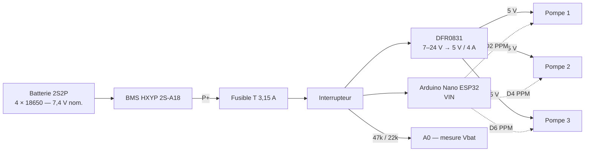

# Iode injection rayon X

Boîtier portable sur batterie pilotant **3 pompes péristaltiques DFRobot DFR0523** de façon séquentielle (3 s chacune) à l'aide d'un **Arduino Nano ESP32**. La LED RGB du Nano indique la pompe active.

| Document | Contenu |
|---|---|
| [docs/nomenclature.md](docs/nomenclature.md) | Liste du matériel avec références fournisseur |
| [docs/schema_electrique.md](docs/schema_electrique.md) | Schéma électrique complet (batterie, BMS, alimentation, pompes, mesure Vbat) |
| [docs/points_ouverts.md](docs/points_ouverts.md) | Points à régler / vérifier avant montage définitif |
| [firmware/iode_injection/iode_injection.ino](firmware/iode_injection/iode_injection.ino) | Firmware Arduino (séquence, LED, surveillance batterie) |

## 1. Principe

### Séquence

1. Pompe 1 pendant 3 s, puis arrêt.
2. Pompe 2 pendant 3 s, puis arrêt.
3. Pompe 3 pendant 3 s, puis arrêt.
4. Les trois pompes restent arrêtées jusqu'au prochain cycle (déclenché par bouton poussoir dans le firmware fourni).

Les débits réels devront être **calibrés avec le liquide utilisé** (le volume dépend du tube, du liquide et de la vitesse).

## 2. Caractéristiques clés (fiches constructeur)

| Élément | Donnée |
|---|---|
| DFR0523 | Alimentation 5–6 V, commande par signal PPM type servo : 500–1400 µs sens horaire, 1400–1600 µs arrêt, 1600–2500 µs sens anti-horaire. Logique 3,3 V acceptée. |
| DFR0831 | Entrée 7–24 V, sortie 5 V / 4 A max (20 W), 6 sorties. |
| Nano ESP32 | VIN 6–21 V, E/S en 3,3 V, LED RGB intégrée (active à l'état bas). |

## 3. Firmware

- Carte : **Arduino Nano ESP32** (core Arduino ESP32 ≥ 3.x).
- Bibliothèque : **ESP32Servo** (gestionnaire de bibliothèques Arduino).
- Signal d'arrêt écrit sur les 3 sorties dès le démarrage.
- Cycle lancé par un bouton poussoir (D7 → GND), refusé si la batterie est sous le seuil `VBAT_MIN`.
- LED : rouge = pompe 1, vert = pompe 2, bleu = pompe 3 ; rouge clignotant = batterie faible.

## 4. Sécurité

- Accus hors circuit tant que câblage et polarités ne sont pas vérifiés au multimètre.
- Toutes les masses communes (P−, IN−/GND DFR0831, GND pompes, GND Nano).
- Les pompes ne doivent **jamais** être alimentées par le Nano ou le shield Grove : uniquement le signal.
- Séparer physiquement la partie hydraulique (têtes de pompe, tubes) de l'électronique dans le boîtier pour qu'une fuite ne tombe pas sur les cartes.
